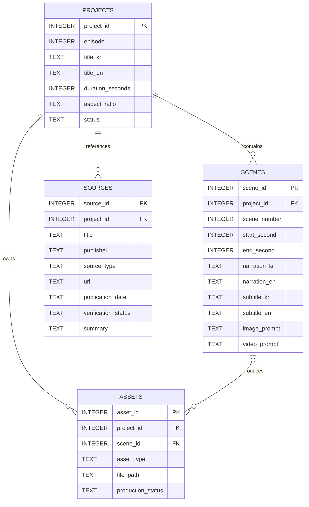
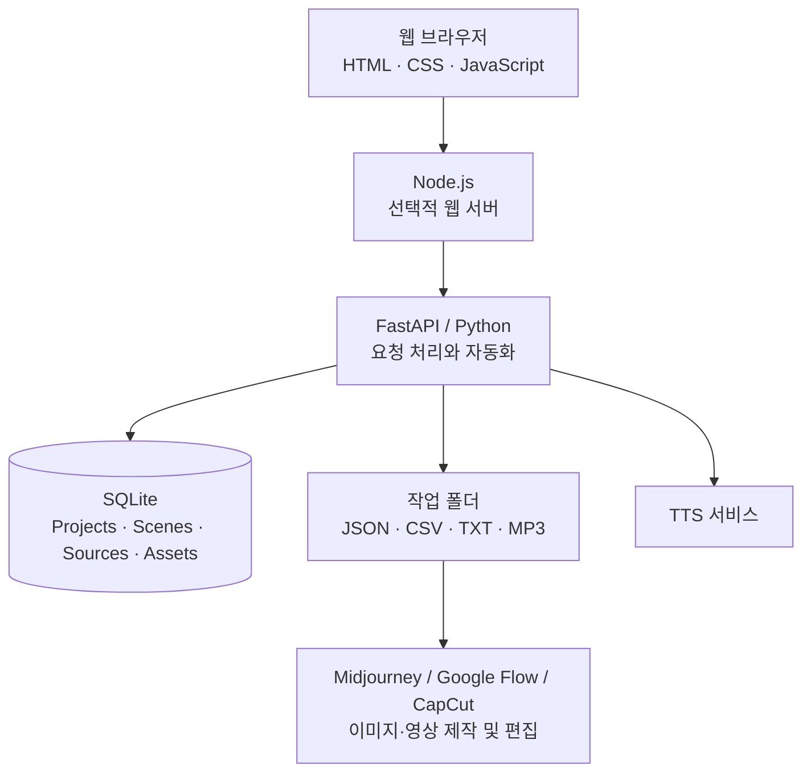

# 조선시대 사람들은 시간을 어떻게 알았을까? — AI 영상 제작 시스템 설계

> **MBC AI 저널리즘 · 설계 문서 (1~5단계)**  
> 프로젝트 위치: `Joseon_Time/` · 문서 상태: **설계안** · 대상 영상: 약 60초, 세로 9:16

## 목차

1. [프로젝트 소개](#1-프로젝트-소개)
2. [기능정의서](#2-기능정의서)
3. [화면구성도](#3-화면구성도)
4. [DB 설계](#4-db-설계)
5. [데이터 수집 방법](#5-데이터-수집-방법)
6. [개발 환경](#6-개발-환경)
7. [실행 방법](#7-실행-방법)
8. [테스트 항목](#8-테스트-항목)

---

## 1. 프로젝트 소개

### 주제와 목표

**주제:** 조선시대 사람들은 시간을 어떻게 알았을까?

조선의 해시계 **앙부일구**, 자동 물시계 **자격루**, 도성의 **종소리와 시간 알림 체계**를 쉽게 설명하는 **60초 교육 영상**을 제작한다. 영상 제작에 필요한 역사 자료, 대본, 장면 정보와 결과물을 관리하고, 반복적인 파일 생성 및 음성 합성을 자동화하는 관리 도구를 설계한다.

- **주요 시청자:** 한국 문화·역사에 관심 있는 외국인과 한국의 중·고등학생
- **영상 형식:** YouTube Shorts, 약 60초, 9:16 세로, 1080×1920
- **콘텐츠:** 8개 장면, 한국어·영어 나레이션 및 자막
- **시각화:** 시네마틱 역사 다큐멘터리 스타일. 앙부일구·자격루의 형태 및 시대 고증 확인
- **범위:** 자료 수집 → 데이터·대본 관리 → 폴더 및 TTS 생성 → 이미지·영상 제작 보조 → 편집·검수

**역사 검증 주의:** 앙부일구의 최초 제작과 현재 전하는 후대 유물을 구분하고, 자격루와 도성의 종소리를 하나의 완전 자동 연동 장치처럼 단정하지 않는다.

### 화면 이미지 자리

> 🖼️ **[화면 이미지 삽입 예정]**  
> 추후 제작 관리 대시보드 스크린샷 또는 9:16 영상 대표 이미지를 여기에 추가한다.  
> 예시 경로: `assets/dashboard-preview.png` (현재 생성되지 않은 예시 경로)

---

## 2. 기능정의서

| ID | 기능 | 설명 | 처리 구분 |
|---|---|---|---|
| F01 | 프로젝트 생성 | 제목, EP 번호, 영상 길이·비율, 언어 등 입력 및 저장 | 자동 |
| F02 | 제작표 관리 | JSON의 8개 장면·대본·프롬프트 불러오기 | 자동 |
| F03 | 폴더·파일 생성 | 제작용 하위 폴더 및 텍스트 파일 준비 | 자동 |
| F04 | 자료 수집·등록 | CSV, Open API, PDF, 웹 기사 출처 및 검증 기록 | 반자동/확장 |
| F05 | 대본·자막 관리 | 한국어·영어 나레이션과 자막을 장면별로 분리 | 자동 |
| F06 | TTS 음성 생성 | 한국어·영어 나레이션 MP3 생성 및 파일 경로 보관 | 자동/외부 API |
| F07 | 이미지 제작 지원 | 장면별 이미지 프롬프트 정리; 실제 이미지 생성은 외부 도구에서 | 반자동 |
| F08 | 영상 제작 지원 | 필요한 장면의 Google Flow 영상 프롬프트 제공 | 반자동 |
| F09 | 편집 계획 관리 | CapCut/Premiere 타임라인, BGM, SFX, 전환 효과 기록 | 자동/수동 |
| F10 | 최종 검수 | 출처, 장면 합계 60초, 음성 재생시간, 자막·파일 확인 | 반자동 |

> **처리 구분**은 최종 시스템의 목표 기능을 뜻한다. 모든 기능의 실제 동작이 검증됐다는 의미는 아니다.

---

## 3. 화면구성도

### 메뉴 구조

```text
영상 제작 관리 시스템
├─ ① 대시보드
│  └─ 프로젝트 제목 · 진행률 · 장면 수 · 제작 상태
├─ ② 프로젝트/장면 관리
│  └─ 한국어·영어 대본 및 자막 · Scene 01~08 · 시간표
├─ ③ 역사 자료 관리
│  └─ 출처 · URL · 발행일 · CSV/API/PDF · 검증 상태
├─ ④ 음성/미디어 관리
│  └─ TTS 실행 요청 · MP3 경로 · 이미지/영상 프롬프트
└─ ⑤ 편집/결과물
   └─ CapCut 계획 · BGM/SFX · 체크리스트 · 최종 영상
```

### 대시보드 와이어프레임 (설계 예시)

```text
┌─────────────────────────────────────────────────────────────────┐
│ Joseon Time Studio                                              │
│ [대시보드] [장면 관리] [자료 관리] [음성 생성] [최종 결과]         │
├─────────────────────────────────────────────────────────────────┤
│ 프로젝트: 조선시대 사람들은 시간을 어떻게 알았을까?              │
│ 영상: 60초 | 9:16 | 8 Scene | KR/EN                           │
│ 제작 진행률: [□□□□□□□□□□] (표시값은 구현 시 계산)                │
├─────────────────────────────────────────────────────────────────┤
│ 장면   시간        주제                 이미지/영상   상태        │
│ 01     00:00~04   한양의 시간          이미지       미확인      │
│ 02     00:04~10   앙부일구와 백성      영상         미확인      │
│ 03~08  ...         ...                  ...          ...         │
├─────────────────────────────────────────────────────────────────┤
│ [대본 확인] [출처 확인] [TTS 생성] [편집표 확인]                   │
└─────────────────────────────────────────────────────────────────┘
```

- **입력:** 프로젝트 정보, 원본 자료, 장면별 대본·프롬프트
- **출력:** 장면 및 자료 목록, 음성 파일 경로, 제작 상태, 검수 체크리스트
- **화면 구현:** HTML·CSS·JavaScript로 구성하고 FastAPI의 API를 호출하도록 설계한다.

---

## 4. DB 설계

초기 데이터베이스로 설치 부담이 적은 **SQLite**를 사용한다. 영상 한 편에 여러 Scene과 자료·에셋이 연결되는 관계를 설계한다.

### ERD (Mermaid)



### 테이블 정의

| 테이블 | 목적 | 주요 데이터 |
|---|---|---|
| `projects` | 영상 프로젝트 기본정보 | EP, 제목, 길이, 화면 비율, 상태 |
| `scenes` | 각 장면의 제작 정보 | 순서, 시작·종료 시간, 한·영 대본·자막, 프롬프트 |
| `sources` | 근거 자료와 검증 기록 | 출처, URL, 유형, 날짜, 요약, 검증 상태 |
| `assets` | 제작된 결과 파일 연결 | 이미지·동영상·음성·완성본 파일 경로 및 상태 |

- `PK`(기본 키): 각 데이터 행을 구별하는 번호
- `FK`(외래 키): 관련된 프로젝트 또는 장면의 번호
- `ASSETS.scene_id`는 장면과 연결되지 않는 전체 영상 에셋의 경우 비워둘 수 있다.
- 장면의 `end_second - start_second` 합계는 목표인 **60초**여야 한다.

---

## 5. 데이터 수집 방법

| 방식 | 수집할 자료 | 처리·활용 | 현재 범위 |
|---|---|---|---|
| CSV 다운로드 | 기사·유물 참고자료 목록 | Python `csv` 또는 pandas로 읽어 `sources`에 입력 | 기본 자료 관리 |
| Open API | 공공기관 문화유산 공개 데이터 | 제공기관의 API 규격·인증·이용조건 확인 후 JSON/XML 파싱 | 연동 설계 / 작성 예정 |
| PDF | 보고서, 역사 논문, 박물관 자료 | 텍스트 추출 후 사실·페이지·출처를 기록 | 자동 처리 작성 예정 |
| 웹 기사·공식 페이지 | 앙부일구·자격루 관련 보도 및 설명 | 링크·제목·날짜·핵심 요약·확인 상태 저장 | 수동 검증 병행 |

### 참고 자료

- [국가유산포털 — 앙부일구](https://www.heritage.go.kr/heri/cul/culSelectDetail.do?ccbaKdcd=12&ccbaAsno=08450000&ccbaCtcd=11&ccbaCpno=1121108450000)
- [국가유산디지털서비스 — 앙부일구](https://digital.khs.go.kr/heri/heriDetail.do?ctptUid=13914999238081009081&ctptNo=1121121590000)
- [MBC 뉴스 — 자격루 복원](https://imnews.imbc.com/replay/2007/nwdesk/article/2095478_30657.html)
- [KBS 영상한국사 — 관련 영상](https://www.youtube.com/watch?v=KCPoo6FRVkA)
- [iMBC — 자격루 관련 기사](https://enews.imbc.com/News/RetrieveNewsInfo/276211)

**검증 원칙:** 핵심 역사 사실은 가능하면 두 곳 이상에서 대조한다. 기사 전체를 무단 복제하지 않고 요약·출처 중심으로 기록한다. 자료의 직접 URL이 있다는 사실만으로 Open API 연결이 구현된 것은 아니다.

### 데이터 흐름

```text
CSV / Open API / PDF / 공식 자료 · 뉴스
                  ↓
        수집 · 파싱 · 중복 확인
                  ↓
           출처 · 사실 검증
                  ↓
               SQLite
                  ↓
       장면별 대본 · 제작 계획
```

---

## 6. 개발 환경

| 구분 | 기술 | 역할 |
|---|---|---|
| 운영체제 | Windows 11 | 개발·제작 환경 |
| 편집기 | VS Code | 문서·프로그램 개발 |
| 프로그래밍 언어 | Python 3.14.7 | 자료 처리, 프로젝트 생성, 음성 생성 |
| 웹 화면 | HTML, CSS, JavaScript | 프로젝트 관리 화면 |
| 프런트엔드 서버 | Node.js (선택) | 화면 개발·정적 파일 제공 또는 API 중계 |
| 백엔드 API | FastAPI + Python | 프로젝트·장면·자료 조회 및 자동화 기능 |
| DB | SQLite | 제작 데이터와 자료 보관 |
| 데이터 형식 | CSV, JSON, PDF | 자료 교환 및 수집 |
| TTS | Google TTS 계열 | 대본 기반 음성 파일 생성 |
| 제작 도구 | Midjourney, Google Flow, CapCut | 이미지·영상 생성 및 최종 편집 |
| 형상 관리 | GitHub | 설계 문서·코드 이력 관리 |

### 시스템 구성



> **구현 순서:** 우선 FastAPI+Python+SQLite로 기초 기능을 구성하고, Node.js는 필요할 때 추가한다. Node.js가 FastAPI의 필수 선행 조건은 아니다.  
> **TTS 주의:** 현재 저장소에 있는 `generate_tts.py`는 Google Translate 기반 **gTTS** 실습용이다. Google Cloud 공식 Neural2 Text-to-Speech API와는 다르므로 동일하게 취급하지 않는다.

---

## 7. 실행 방법

**작성 예정**

설계 문서를 기준으로 실행 환경 설치, 설정값, 서버 실행, 파일 생성과 확인 방법을 추후 정리한다.

> 참고: 저장소에 `create_project.py`, `generate_tts.py`, `app.py`, `README_실행방법.md` 등의 **이전 실습용 파일이 이미 존재**한다. 본 README의 실행 절차는 아직 새 설계안 기준으로 확정하지 않았으며, 과거 실습 파일의 동작 여부를 이 문서에서 보증하지 않는다.

---

## 8. 테스트 항목

**작성 예정**

추후 프로젝트·장면 입력, DB 저장·조회, 60초 합계 검사, 출처 검증, TTS 파일 생성, 자막 싱크 및 API 호출 테스트를 구체적인 입력·예상 결과·실제 결과로 정리한다.

---

### 참고: 제작표와 설계의 구분

저장소에 있는 `EP.26 조선시대 사람들은 시간을 어떻게 알았을까.docx`는 실제 영상 제작용 문서이며, 문서 내부 EP 번호가 다른 곳에서는 **EP.32**로 표기된 이력이 있다. 이 README는 **에피소드 번호와 관계없는 시스템 설계 문서**로 정리했다. 세부 대본·프롬프트는 원본 제작표를 참조한다.
